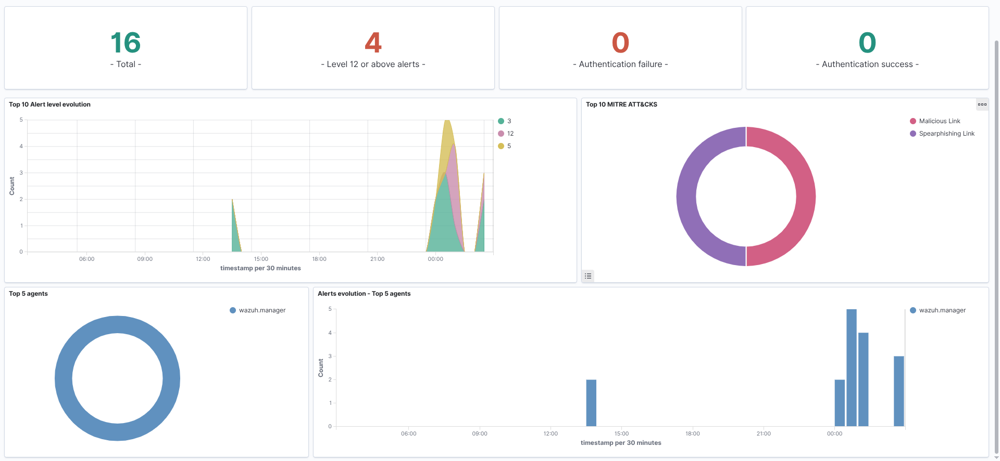

# Phishing Triage & SIEM Detection Engineering Lab

<p align="center">
  
  
  
  
</p>

A hands-on security operations lab demonstrating threat intelligence ingestion, email header and MIME forensics, multi-engine payload scanning, evasion analysis, and custom detection rule engineering in Wazuh SIEM.

---

## <a id="overview"></a>📌 Overview

Modern phishing attacks often bypass Secure Email Gateways (SEGs) and commercial antivirus engines through optical, header, and archive-level evasion techniques—ranging from image-rendered lures and zero-width Unicode homoglyphs to leveraging trusted cloud storage infrastructure.

This project examines key stages of the email triage and detection engineering workflow:

| Phase | Operational Focus | Key Technologies / Frameworks |
| :--- | :--- | :--- |
| **1. Ingestion** | Collecting phishing feeds and analyzing raw `.eml` messages | OpenPhish, RFC 5322 MIME Parser, Python |
| **2. Email Forensics** | Evaluating authentication alignment, routing hops, and headers | SPF, DKIM, DMARC, Return-Path vs From analysis |
| **3. Payload Deconstruction** | Extracting embedded objects, stream parsing, and archive analysis | `qpdf`, `pdfimages`, `pdftotext`, `unzip`, Hex inspection |
| **4. Evasion Analysis** | Documenting OCR-evasive image lures and padded ZIP offsets | Binary Offset Inspection, Unicode Homoglyph Analysis |
| **5. Threat Intelligence** | Multi-engine payload scanning, hash tracking, and IOC normalization | VirusTotal scanner, MITRE ATT&CK Enterprise Matrix |
| **6. SIEM Detection Eng.** | Building custom XML decoders, binary CDB hash lists, and correlation rules | Wazuh SIEM, OpenSearch, `wazuh-logtest`, XML, Regex |

---

## <a id="quick-highlights"></a>💡 Quick Project Highlights (TL;DR)

- **Payload Scanning:** Submitted the rewritten PDF (`1000_flat.pdf`) to VirusTotal; 1 of 62 security engines flagged the file (Microsoft Defender flagged it as `Trojan:PDF/Phish!atmn`).
- **Evasion Observations:** Examined a single-page raster image lure designed without selectable text, and observed 6 extra padding bytes with offset warnings in a DOCX archive (possible evasion technique or file artifact).
- **SIEM Rule Engineering:** Configured a custom XML decoder (`custom_proxy`), binary CDB threat list (`phishing-iocs.cdb`), and correlation rule (`Rule 100200`, Level 12) in a local Wazuh SIEM stack.
- **Baseline Testing:** Tested true-positive threat logs and verified that a benign test domain (`google.com`) did not trigger the rule in testing.

---

## 📑 Table of Contents

- [📌 Overview](#overview)
- [💡 Quick Project Highlights (TL;DR)](#quick-highlights)
- [🛠️ Lab Architecture & Detection Pipeline](#lab-architecture)
- [🔬 Forensic Case Studies & Evasion Analysis](#case-studies)
  - [1. Sample 1000: Image-Only Lure & Cloud Storage Link](#sample-1000)
  - [2. Sample 10017: Unicode Homoglyphs & Archive Header Padding](#sample-10017)
  - [3. Sample 1001: Brand Spoofing & Unresolvable Domain Triage](#sample-1001)
  - [4. Live Threat Feed: Jimdofree Campaign Infrastructure Clustering](#live-feeds)
- [🎯 MITRE ATT&CK Matrix Mapping](#mitre-attack)
- [🛡️ Wazuh SIEM Detection Engineering](#detection-engineering)
  - [1. Threat Intelligence CDB List](#cdb-list)
  - [2. Custom XML Proxy Log Decoder](#proxy-decoder)
  - [3. Custom Level 12 Correlation Rule](#correlation-rule)
  - [4. Engine Verification with `wazuh-logtest`](#engine-verification)
  - [5. Live SIEM Dashboard & OpenSearch Evidence](#siem-dashboard)
- [⚠️ Limitations & Scope](#limitations)
- [🔒 Safety & Handling](#safety)
- [📂 Repository Structure](#repo-structure)
- [🧪 How to Reproduce & Verify Detections](#reproduction)
- [🚀 Key SOC Operational Takeaways](#key-takeaways)
- [🙏 Credits & Threat Intelligence Sources](#credits)
- [👤 Author & Contact](#author-contact)

---

## <a id="lab-architecture"></a>🛠️ Lab Architecture & Detection Pipeline

```
[ Inbound Threat Stream ] 
       │
       ▼
[ Forensic Triage & Extraction ] 
       │  ├── Header Alignment (SPF / DKIM / DMARC Authentication)
       │  ├── Attachment Deconstruction (qpdf, pdfimages, unzip header parsing)
       │  └── Isolated URL Probing (curl in a Docker container)
       ▼
[ Threat Intelligence & Correlation ] 
       │  ├── Multi-Engine Scanning (VirusTotal web scanner)
       │  ├── IOC Normalization & Defanging (iocs.csv)
       │  └── MITRE ATT&CK Tactic & Technique Tagging
       ▼
[ Wazuh SIEM Detection Engine ] 
       │  ├── Simulated Web Proxy Log Stream (/var/ossec/logs/proxy.log)
       │  ├── Custom XML Decoder (local_decoder.xml -> srcip, domain)
       │  └── Binary CDB Table Lookup (phishing-iocs.cdb)
       ▼
[ Security Alert & Telemetry ] 
          Rule 100200 Fired (Level 12 Severity) 
          Indexed in OpenSearch & Populated into Wazuh MITRE Dashboard
```

---

## <a id="case-studies"></a>🔬 Forensic Case Studies & Evasion Analysis

### <a id="sample-1000"></a>1. Sample 1000: Image-Only Lure & Cloud Storage Link
> [📄 Read Full Forensic Report (Sample 1000)](reports/report-sample-1000.md)

* **Lure:** Fake Banco do Brasil (`[BB]`) tax refund notification claiming an available balance of `R$ 4.593,21`.
* **Authentication Vector:** SPF `pass`, DKIM `pass`, DMARC `pass` via authentic personal Gmail infrastructure, demonstrating that email authentication verifies sending host authorization rather than whether content is benign.
* **Evasion Mechanism:** Standard text parsers (`pdftotext`) extracted only randomized characters (`r6WceZWcCCv8YN`). Graphic stream analysis (`pdfimages`) revealed the entire page was rendered as a single raster bitmap (`img1000-000.png`), leaving no selectable text for standard keyword filters or basic OCR scanners.
* **Payload Link:** Low-level object stream analysis (`qpdf`) extracted an active `/URI` linking to an external site:  
  `hxxps://okokoaksoa[.]z13[.]web[.]core[.]windows[.]net/`  
  *Note:* The hostname (`*.web.core.windows.net`) is consistent with Azure Storage static website hosting, which is often abused to host static lures on reputable cloud domains.
* **Attachment Hashes & Scanning:**  
  * Original attachment: `csWuYjyqO2IR.pdf` (SHA-256: `cfc5fbc7ec4a390d4fbb1b489a243a859437146522c0199e4b370ef3749330cf`).
  * Rewritten uncompressed file: `1000_flat.pdf` (SHA-256: `7857626ee81ec5fafb579dbf47fecdb92615444ac4d719326e789a37c0af3f0e`).
  * When `1000_flat.pdf` was submitted to VirusTotal, 1 of 62 security engines flagged the file. Microsoft Defender labeled it as **`Trojan:PDF/Phish!atmn`**. Because the PDF primarily wraps a static bitmap and a hyperlink, the structure presents few traditional executable signatures for static antivirus engines.

<p align="center">
  
  <br>
  <em>Figure 1: Extracted full-page raster bitmap lure (img1000-000.png) with embedded yellow call-to-action button.</em>
</p>

<p align="center">
  
  <br>
  <em>Figure 2: Forensic object stream extraction revealing the single bitmap object (ID 4 0) and the Azure Storage link.</em>
</p>

<p align="center">
  
  <br>
  <em>Figure 3: VirusTotal detection panel for 1000_flat.pdf. Microsoft Defender flagged the file as Trojan:PDF/Phish!atmn (1/62 engines).</em>
</p>

<p align="center">
  
  <br>
  <em>Figure 4: VirusTotal metadata panel confirming document details and SHA-256 hash.</em>
</p>

---

### <a id="sample-10017"></a>2. Sample 10017: Unicode Homoglyphs & Archive Header Padding
> [📄 Read Full Forensic Report (Sample 10017)](reports/report-sample-10017.md)

* **Lure:** Account security notification impersonating Kraken Security.
* **Header Evasion:** Injected non-printable zero-width Unicode characters (`U+E0139`, `U+E0137`) and Cyrillic homoglyphs (`а`, `е`) into the display name (`Κ󠄹󠄹r󠄹а󠄹󠄹󠄹k󠄹е󠄹󠄹ո󠄹 Secu󠄹󠄹rity`) to evade simple ASCII regex keyword detection.
* **Payload Evasion:** Attached Word document (`Regulation Wed, July 08, 2026.docx`) contained 6 prepended padding bytes and corrupted local header offsets. When tested with `unzip`, offset warnings were reported; however, Microsoft Word opened the document without error. This may represent an intentional evasion technique designed to cause strict automated unpackers to fail, or an artifact of how the archive was assembled.

<p align="center">
  
  <br>
  <em>Figure 5: Unzip warning showing offset compensation and padding bytes encountered during inspection.</em>
</p>

---

### <a id="sample-1001"></a>3. Sample 1001: Brand Spoofing & Unresolvable Domain Triage
> [📄 Read Full Forensic Report (Sample 1001)](reports/report-sample-1001.md)

* **Lure:** Security alert regarding unusual sign-in activity impersonating Microsoft.
* **Header Mismatch:** Severe cross-vector identity anomalies:
  * Header From: `no-reply@access-accsecurity[.]com` (lookalike domain)
  * Return-Path: `bounce@nonkfrgr[.]co[.]uk`
  * Reply-To: `solutionteamrecognizd02@gmail[.]com` (free webmail collection mailbox)
  * Authentication: SPF `none`, DKIM `none`, DMARC `permerror`.
* **Domain Triage:** DNS lookup for `thebandalisty[.]com` returned `NXDOMAIN`, indicating that the domain was not resolving at the time of investigation.

<p align="center">
  
  <br>
  <em>Figure 6: DNS query showing NXDOMAIN resolution for thebandalisty.com alongside comparison lookup.</em>
</p>

---

### <a id="live-feeds"></a>4. Live Threat Feed: Jimdofree Campaign Infrastructure Clustering

* Probing live OpenPhish threat feeds uncovered 3 phishing endpoints targeting French webmail and postal service users (`AR24`):
  * `accueilboitear24seconnecte77.jimdofree[.]com`
  * `accueilsurlespacear24-8744.jimdofree[.]com`
  * `webmailar24.jimdofree[.]com`
* **Finding:** All 3 active endpoints resolve to the IP address `185.60.251.252`. Because Jimdofree is a shared website hosting and site-builder service, a shared IP is expected for sites hosted on that platform.

<p align="center">
  
  <br>
  <em>Figure 7: Automated curl triage tracking HTTP status codes, redirects, and resolved IPs inside a container.</em>
</p>

---

## <a id="mitre-attack"></a>🎯 MITRE ATT&CK Matrix Mapping

| Tactic | Technique ID | Technique Name | Context in Lab |
| :--- | :--- | :--- | :--- |
| **Initial Access** | **[T1566.001](https://attack.mitre.org/techniques/T1566/001/)** | Spearphishing Attachment | Delivery of PDF and decoy DOCX attachments |
| **Initial Access** | **[T1566.002](https://attack.mitre.org/techniques/T1566/002/)** | Spearphishing Link | Phishing links embedded within message bodies and attachments |
| **Defense Evasion**| **[T1027](https://attack.mitre.org/techniques/T1027/)** | Obfuscated/Encrypted Info | Zero-width Unicode homoglyphs, malformed ZIP headers, rasterized PDF text |
| **Initial Access** | **[T1656](https://attack.mitre.org/techniques/T1656/)** | Impersonation | Impersonating Banco do Brasil, Kraken Security, and Microsoft |
| **Resource Dev**   | **[T1583.001](https://attack.mitre.org/techniques/T1583/001/)** | Acquire Infrastructure: Domains | Attacker infrastructure domains (valid SPF/DKIM observed in Sample 1000 via Gmail) |
| **Resource Dev**   | **[T1583.006](https://attack.mitre.org/techniques/T1583/006/)** | Acquire Infrastructure: Web Services | Using Azure Storage static websites and Vercel hosting |
| **Execution**      | **[T1204.001](https://attack.mitre.org/techniques/T1204/001/)** | User Execution: Malicious Link | User clicking link directing to external site |
| **Execution**      | **[T1204.002](https://attack.mitre.org/techniques/T1204/002/)** | User Execution: Malicious File | User opening decoy document attachment |

---

## <a id="detection-engineering"></a>🛡️ Wazuh SIEM Detection Engineering

### <a id="cdb-list"></a>1. Threat Intelligence CDB List (`etc/lists/phishing-iocs`)
Extracted domains from forensic investigation and live feeds are compiled into binary CDB hash tables for constant-time lookup:
```text
okokoaksoa.z13.web.core.windows.net:phishing
webmailar24.jimdofree.com:phishing
access-accsecurity.com:phishing
system-update-account-ilpro.vercel.app:phishing
```

### <a id="proxy-decoder"></a>2. Custom Proxy Log Decoder (`local_decoder.xml`)
Extracts the source IP and target domain fields from simulated proxy access events:
```xml
<decoder name="custom_proxy">
  <program_name>proxy</program_name>
  <regex>src=(\S+)\s+domain=(\S+)</regex>
  <order>srcip, domain</order>
</decoder>
```

### <a id="correlation-rule"></a>3. Custom Correlation Rule (`local_rules.xml`)
Correlates parsed domains against the binary threat intelligence list, triggers high-severity alerts, and tags MITRE ATT&CK techniques:
```xml
<group name="web,proxy,phishing,">
  <rule id="100200" level="12">
    <decoded_as>custom_proxy</decoded_as>
    <list field="domain" lookup="match_key">etc/lists/phishing-iocs</list>
    <description>Outbound connection to known phishing domain ($(domain)) detected</description>
    <mitre>
      <id>T1566.002</id>
      <id>T1204.001</id>
    </mitre>
  </rule>
</group>
```

### <a id="engine-verification"></a>4. Verification with `wazuh-logtest`

Simulating an outbound request from workstation `10.0.0.5` to a known threat domain:
```bash
echo "Oct 23 10:15:01 proxy01 proxy: src=10.0.0.5 domain=webmailar24.jimdofree.com" | docker exec -i single-node-wazuh.manager-1 /var/ossec/bin/wazuh-logtest
```

**Engine Output:**
```text
**Phase 1: Completed pre-decoding.
	full event: 'Oct 23 10:15:01 proxy01 proxy: src=10.0.0.5 domain=webmailar24.jimdofree.com'
	timestamp: 'Oct 23 10:15:01'
	hostname: 'proxy01'
	program_name: 'proxy'

**Phase 2: Completed decoding.
	name: 'custom_proxy'
	domain: 'webmailar24.jimdofree.com'
	srcip: '10.0.0.5'

**Phase 3: Completed filtering (rules).
	id: '100200'
	level: '12'
	description: 'Outbound connection to known phishing domain (webmailar24.jimdofree.com) detected'
	groups: '['web', 'proxy', 'phishing']'
	firedtimes: '1'
	mail: 'True'
	mitre.id: '['T1566.002', 'T1204.001']'
	mitre.tactic: '['Initial Access', 'Execution']'
	mitre.technique: '['Spearphishing Link', 'Malicious Link']'

**Alert to be generated.
```

**Baseline Test:**  
Testing benign web traffic (`domain=google.com`) verified that while logs decode cleanly in Phase 2, **Rule 100200 does not trigger in testing**.

### <a id="siem-dashboard"></a>5. Live SIEM Dashboard & MITRE ATT&CK Matrix Verification

The detection pipeline was verified by streaming simulated proxy events into `/var/ossec/logs/proxy.log` on a local Wazuh SIEM stack running in Docker (`wazuh.manager`, `wazuh.indexer` / OpenSearch, and `wazuh.dashboard`).

Test alerts fired at **Level 12 severity**, matching CDB threat list entries and displaying in the Wazuh dashboard:

<p align="center">
  
  <br>
  <em>Figure 8: Wazuh SIEM Security Events Table showing Rule 100200 triggers.</em>
</p>

<p align="center">
  
  <br>
  <em>Figure 9: Alerts Summary aggregated by extracted domains.</em>
</p>

<p align="center">
  
  <br>
  <em>Figure 10: MITRE ATT&CK Tactics & Technique Distribution (T1566.002 & T1204.001).</em>
</p>

<p align="center">
  
  <br>
  <em>Figure 11: Wazuh SIEM Overview Dashboard showing alert telemetry.</em>
</p>

---

## <a id="limitations"></a>⚠️ Limitations & Scope

This project was built as an educational lab to practice triage, forensics, and detection logic. Several practical constraints apply:

1. **Sample Size:** In-depth forensic analysis focused on three case studies and a small cluster of live URLs; it is not a comprehensive statistical sample of modern phishing campaigns.
2. **Simulated Telemetry:** Ingested proxy logs were manually simulated and piped via `wazuh-logtest` and `/var/ossec/logs/proxy.log` rather than generated by a live enterprise proxy appliance.
3. **Detection Scope:** Detection engineering is based on an exact-match domain list (`phishing-iocs.cdb`) and a single correlation rule (Rule 100200). It does not detect novel, uncatalogued domains, dynamic DNS permutations, or downstream host-level post-exploitation.
4. **Post-Delivery Analysis:** Forensics were performed post-delivery on raw `.eml` files; inline Secure Email Gateway (SEG) rejection and quarantine mechanisms were not evaluated in a live mail flow.

---

## <a id="safety"></a>🔒 Safety & Handling

- **Defanged Indicators:** All URLs, domains, and IP addresses in documentation and notes are defanged (e.g., `hxxps://`, `[.]`) to prevent accidental clicks or automated scraping.
- **Isolated Environment:** All file triage, deconstruction (`qpdf`, `pdfimages`, `unzip`), and URL probing (`curl`) were conducted in isolated Linux environments and containers without executing untrusted macros or native binaries.
- **Repository Safety:** The `.gitignore` is configured to prevent accidental staging or commits of live executable payloads.

---

## <a id="repo-structure"></a>📂 Repository Structure

```
phish-lab/
├── README.md                              # Comprehensive project documentation & evidence
├── .gitignore                             # Prevents accidental commit of raw malware
├── notes/
│   ├── iocs.csv                           # Defanged Indicator of Compromise master table
│   ├── decoder_architecture_explained.txt # SIEM decoder trees, regex ordering & pre-decoding guide
│   ├── wazuh_working_for_phishingmail.txt # Email ingestion architecture & simulation mechanics
│   ├── analysis_guide.txt                 # Phishing triage & log correlation field guide
│   ├── wazuh-quickstart.txt               # Manager reload command reference
│   ├── virustotal/                        # VirusTotal scans and Trojan metadata
│   ├── wazuh_evidence/                    # Wazuh SIEM events, alerts & dashboard screenshots
│   └── docx_images/media/                 # Forensic evidence captures and extracted visual lures
├── reports/
│   ├── report-sample-1000.md              # Incident report: Banco do Brasil (PDF image lure & Azure link)
│   ├── report-sample-1001.md              # Incident report: Microsoft Account (header spoofing & NXDOMAIN)
│   └── report-sample-10017.md             # Incident report: Kraken Security (homoglyphs & archive header padding)
└── wazuh/
    ├── lists/phishing-iocs                # CDB threat intelligence lookup list
    ├── decoders/local_decoder.xml         # Custom proxy log decoder
    ├── rules/local_rules.xml              # Detection rule 100200 with MITRE ATT&CK tags
    └── test_results.txt                   # Captured wazuh-logtest verification outputs
```

---

## <a id="reproduction"></a>🧪 How to Reproduce & Verify Detections

### 1. Test Detections with `wazuh-logtest`
If running Wazuh in Docker, execute:
```bash
# Test True-Positive Threat Ingestion
echo "Oct 23 10:15:01 proxy01 proxy: src=10.0.0.5 domain=webmailar24.jimdofree.com" | \
docker exec -i single-node-wazuh.manager-1 /var/ossec/bin/wazuh-logtest

# Test Benign Baseline Traffic
echo "Oct 23 10:15:01 proxy01 proxy: src=10.0.0.5 domain=google.com" | \
docker exec -i single-node-wazuh.manager-1 /var/ossec/bin/wazuh-logtest
```

### 2. Stream Simulated Proxy Logs
To trigger alerts into OpenSearch and the Wazuh Dashboard:
```bash
docker exec -i single-node-wazuh.manager-1 bash -c \
'echo "Oct 23 10:15:01 proxy01 proxy: src=192.168.1.15 domain=okokoaksoa.z13.web.core.windows.net" >> /var/ossec/logs/proxy.log'
```

---

## <a id="key-takeaways"></a>🚀 Key SOC Operational Takeaways

1. **Authentication $\neq$ Benignity:** Passing SPF, DKIM, and DMARC checks verifies sender domain authorization, not benign content. Adversaries can leverage compromised authentic mailboxes (e.g., personal webmail accounts) to pass perimeter checks.
2. **Multi-Layered Defense-in-Depth:** Optical evasion (full-page bitmap lures) and archive manipulation (padded ZIP header offsets) can bypass basic static string filters and unpackers. Defense requires combining content-aware inspection, archive sanitization, and network proxy / SIEM correlation.
3. **Detection Engineering Discipline:** High-fidelity SIEM rules require structured threat intelligence curation, efficient regex tokenization, binary lookup tables (CDB), and baseline testing against benign activity to reduce alert fatigue.

---

## <a id="credits"></a>🙏 Credits & Threat Intelligence Sources

This lab relies upon real-world threat feeds, open-source forensic datasets, and security research tooling. Sincere gratitude to the creators and maintainers of these platforms:

- **[OpenPhish](https://openphish.com/):** For real-time, automated phishing threat intelligence feeds used for live URL harvesting, redirect analysis, and hosting infrastructure clustering.
- **[Phishing Pot (`rf-peixoto/phishing_pot`)](https://github.com/rf-peixoto/phishing_pot):** Curated by [Rodrigo Peixoto](https://www.linkedin.com/in/rf-peixoto), providing the honeypot-collected corpus of raw `.eml` samples used for deep email header forensics, optical evasion deconstruction, and archive header analysis.
- **[VirusTotal](https://www.virustotal.com/):** For multi-engine commercial payload scanning, behavioral heuristics analysis, and Trojan classification telemetry.
- **[Wazuh Open Source Security Platform](https://wazuh.com/):** For the SIEM/XDR architecture, regex decoding engine, and CDB list lookup mechanisms.
- **[MITRE ATT&CK®](https://attack.mitre.org/):** For providing the globally accessible framework of adversary tactics, techniques, and procedures.

---

## <a id="author-contact"></a>👤 Author & Contact

**Santhosh Tharun**  
*Aspiring SOC Analyst*

- **GitHub:** [@SanthoshTharun7](https://github.com/SanthoshTharun7)
- **Repository:** [email-phishing-siem-lab](https://github.com/SanthoshTharun7/email-phishing-siem-lab)
