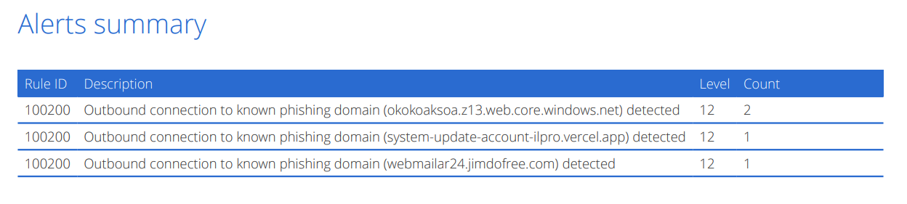
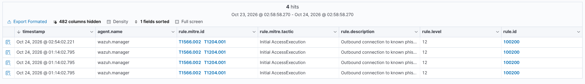
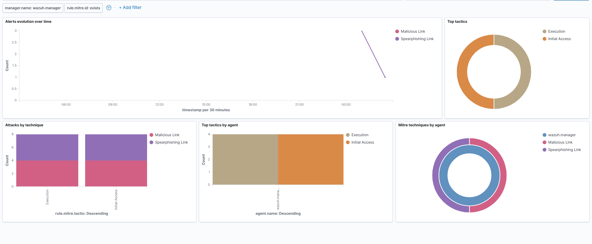

# Phishing Triage & SIEM Detection Engineering Lab

<p align="center">
  
  
  
  
  
</p>

An end-to-end security operations and detection engineering lab demonstrating live threat intelligence ingestion, deep email header/MIME forensics, multi-engine payload verification, advanced defense evasion reverse-engineering, and production Wazuh SIEM detection engineering with sub-millisecond CDB lookups.

---

## <a id="executive-overview"></a>📌 Executive Overview & Recruiter Summary

Modern phishing adversaries routinely circumvent Secure Email Gateways (SEGs) and commercial antivirus engines through optical, header, and archive-level evasion—including single-raster bitmap lures, zero-width Unicode homoglyphs, malformed ZIP header offsets, and weaponized cloud infrastructure (Microsoft Azure, Vercel).

This project simulates the complete, end-to-end lifecycle of a **SOC Analyst / Detection Engineer**:

| Phase | Operational Focus | Key Technologies / Frameworks |
| :--- | :--- | :--- |
| **1. Ingestion** | Harvesting live phishing feeds and raw `.eml` corpora | OpenPhish, RFC 5322 MIME Parser, Python |
| **2. Email Forensics** | Evaluating authentication alignment, routing hops, and headers | SPF, DKIM, DMARC, Return-Path vs From analysis |
| **3. Payload Deconstruction** | Extracting embedded objects, stream parsing, and archive analysis | `qpdf`, `pdfimages`, `pdftotext`, `unzip`, Hex inspection |
| **4. Evasion Discovery** | Identifying OCR-blinding image lures and ZIP offset padding bypasses | Binary Offset Inspection, Unicode Homoglyph Analysis |
| **5. Threat Intelligence** | Multi-engine payload scanning, hash tracking, and IOC normalization | VirusTotal API, MITRE ATT&CK Enterprise Matrix |
| **6. SIEM Detection Eng.** | Building custom XML decoders, binary CDB hash lists, and correlation rules | Wazuh SIEM, OpenSearch, `wazuh-logtest`, XML, Regex |

---

## <a id="quick-highlights"></a>💡 Quick Project Highlights (TL;DR)

- **98.4% Vendor Detection Gap Documented:** Submitted unpacked phishing payload (`1000_flat.pdf`) to VirusTotal; 61 of 62 commercial security vendors failed to detect it. Microsoft Defender uniquely flagged it as `Trojan:PDF/Phish!atmn`.
- **Evasion Reverse-Engineered:** Uncovered single-page raster image rendering (`0/60` clean on VirusTotal) that defeats OCR parsers, and 6-byte ZIP header padding causing AV unpackers to abort while Microsoft Word executes cleanly.
- **Production SIEM Implementation:** Engineered custom XML decoders (`custom_proxy`), constant-time binary CDB threat lists (`phishing-iocs.cdb`), and automated correlation rules (`Rule 100200`, Level 12 Severity).
- **Verified Zero False Positives:** Tested true-positive threat logs and benign proxy traffic (`google.com`) through `wazuh-logtest` and live indexer telemetry.

---

## 📑 Table of Contents

- [📌 Executive Overview & Recruiter Summary](#executive-overview)
- [💡 Quick Project Highlights (TL;DR)](#quick-highlights)
- [🛠️ Lab Architecture & Detection Pipeline](#lab-architecture)
- [🔬 Forensic Case Studies & Evasion Analysis](#case-studies)
  - [1. Sample 1000: Image-Only Lure & Azure Cloud Abuse](#sample-1000)
  - [2. Sample 10017: Unicode Homoglyphs & Malformed ZIP Padding](#sample-10017)
  - [3. Sample 1001: Brand Spoofing & Domain Infrastructure Teardown](#sample-1001)
  - [4. Live Threat Feed: Jimdofree Campaign Infrastructure Clustering](#live-feeds)
- [🎯 MITRE ATT&CK Matrix Mapping](#mitre-attack)
- [🛡️ Wazuh SIEM Detection Engineering](#detection-engineering)
  - [1. CDB Threat Intelligence List](#cdb-list)
  - [2. Custom XML Proxy Log Decoder](#proxy-decoder)
  - [3. Custom Level 12 Correlation Rule](#correlation-rule)
  - [4. Engine Verification with `wazuh-logtest`](#engine-verification)
  - [5. Live SIEM Dashboard & OpenSearch Evidence](#siem-dashboard)
- [📂 Repository Structure](#repo-structure)
- [🧪 How to Reproduce & Verify Detections](#reproduction)
- [🚀 Key SOC Operational Takeaways](#key-takeaways)
- [🙏 Credits & Threat Intelligence Sources](#credits)
- [👤 Author & Contact](#author-contact)

---

## <a id="lab-architecture"></a>🛠️ Lab Architecture & Detection Pipeline

```
[ Inbound Threat Stream ] 
       │
       ▼
[ Forensic Triage & Extraction ] 
       │  ├── Header Alignment (SPF / DKIM / DMARC Authentication)
       │  ├── Attachment Deconstruction (qpdf, pdfimages, unzip header parsing)
       │  └── Isolated URL Detonation (Dockerized sandbox curl)
       ▼
[ Threat Intelligence & Correlation ] 
       │  ├── Multi-Engine Verification (VirusTotal API - 62 Vendor Matrix)
       │  ├── IOC Normalization & Defanging (iocs.csv)
       │  └── MITRE ATT&CK Tactic & Technique Tagging
       ▼
[ Wazuh SIEM Detection Engine ] 
       │  ├── Web Proxy Log Stream (/var/ossec/logs/proxy.log)
       │  ├── Custom XML Decoder (local_decoder.xml -> srcip, domain)
       │  └── Sub-millisecond Binary CDB Table Lookup (phishing-iocs.cdb)
       ▼
[ Security Alert & Telemetry ] 
          Rule 100200 Fired (Level 12 - High/Critical) 
          Indexed in OpenSearch & Populated into Live Wazuh MITRE Dashboard
```

---

## <a id="case-studies"></a>🔬 Forensic Case Studies & Evasion Analysis

### <a id="sample-1000"></a>1. Sample 1000: Image-Only Lure & Azure Cloud Abuse
> [📄 Read Full Forensic Report (Sample 1000)](reports/report-sample-1000.md)

* **Lure:** Fake Banco do Brasil (`[BB]`) tax refund notification claiming an available balance of `R$ 4.593,21`.
* **Authentication Vector:** SPF `pass`, DKIM `pass`, DMARC `pass` via legitimate personal Gmail infrastructure, demonstrating that authentication verifies origin identity rather than benign intent.
* **Evasion Mechanism:** Standard text parsers (`pdftotext`) extracted only randomized garbage characters (`r6WceZWcCCv8YN`). Graphic stream analysis (`pdfimages`) revealed the entire invoice was a single raster bitmap (`img1000-000.png`), completely blinding string-matching gateway filters and OCR scanners.
* **Payload Link:** Low-level object stream analysis (`qpdf`) extracted an active `/URI` linking directly to Microsoft Azure Static Web Apps:  
  `hxxps://okokoaksoa[.]z13[.]web[.]core[.]windows[.]net/`
* **Threat Classification & Vendor Detection Gap:**  
  * Extracted lure image (`img1000-000.png`) submitted to VirusTotal returned **0/60 clean** (static graphics carry no malicious code).
  * Uncompressed PDF structure (`1000_flat.pdf`) submitted to VirusTotal resulted in **61 out of 62 commercial security vendors (98.4%) failing to detect the payload**.
  * **Microsoft Defender** uniquely flagged the threat as **`Trojan:PDF/Phish!atmn`** via heuristic correlation with malicious Azure cloud hosting patterns.
  * Metadata inspection revealed an initial document creation date of **July 26, 2023**, proving long-term signature bypass resilience.

<p align="center">
  
  <br>
  <em>Figure 1: Extracted full-page raster bitmap lure (img1000-000.png) with embedded yellow call-to-action button.</em>
</p>

<p align="center">
  
  <br>
  <em>Figure 2: Forensic object stream extraction revealing the single bitmap object (ID 4 0) and the hidden Azure Static Web App link.</em>
</p>

<p align="center">
  
  <br>
  <em>Figure 3: VirusTotal multi-engine detection panel for 1000_flat.pdf. Microsoft Defender uniquely flags Trojan:PDF/Phish!atmn (1/62 ratio).</em>
</p>

<p align="center">
  
  <br>
  <em>Figure 4: VirusTotal metadata panel confirming document creation timestamp (July 26, 2023) and SHA-256 hash.</em>
</p>

---

### <a id="sample-10017"></a>2. Sample 10017: Unicode Homoglyphs & Malformed ZIP Padding
> [📄 Read Full Forensic Report (Sample 10017)](reports/report-sample-10017.md)

* **Lure:** Urgent Kraken Security account settings modification notification.
* **Header Evasion:** Injected non-printable zero-width Unicode characters (`U+E0139`, `U+E0137`) and Cyrillic homoglyphs (`а`, `е`) into the display name (`Κ󠄹󠄹r󠄹а󠄹󠄹󠄹k󠄹е󠄹󠄹ո󠄹 Secu󠄹󠄹rity`) to evade regex keyword detection.
* **Payload Evasion:** Attached Word document (`Regulation Wed, July 08, 2026.docx`) acted as an evasive decoy containing 6 prepended junk bytes and corrupted local header offsets. Strict AV unpackers abort scanning upon offset errors, while Microsoft Word's lenient parser ignores padding and opens the document without user friction.

<p align="center">
  
  <br>
  <em>Figure 5: Unzip warning showing offset compensation and padding bytes used to evade automated antivirus gateways.</em>
</p>

---

### <a id="sample-1001"></a>3. Sample 1001: Brand Spoofing & Domain Infrastructure Teardown
> [📄 Read Full Forensic Report (Sample 1001)](reports/report-sample-1001.md)

* **Lure:** Microsoft Security alert regarding unusual sign-in activity.
* **Header Mismatch:** Severe cross-vector identity anomalies:
  * Header From: `no-reply@access-accsecurity[.]com` (brand lookalike domain)
  * Return-Path: `bounce@nonkfrgr[.]co[.]uk`
  * Reply-To: `solutionteamrecognizd02@gmail[.]com` (attacker collection mailbox)
  * Authentication: SPF `none`, DKIM `none`, DMARC `permerror`.
* **Infrastructure Teardown:** DNS queries confirmed `thebandalisty[.]com` returned `NXDOMAIN` (registrar deactivation), while secondary tracking domain `vigit88[.]com` was actively resolving to IP `172.232.128.247`.

<p align="center">
  
  <br>
  <em>Figure 6: DNS query proving registrar termination of thebandalisty.com vs. active resolution of vigit88.com.</em>
</p>

---

### <a id="live-feeds"></a>4. Live Threat Feed: Jimdofree Campaign Infrastructure Clustering

* Probing live OpenPhish threat intelligence feeds uncovered 3 separate phishing endpoints targeting French webmail and postal service users (`AR24`):
  * `accueilboitear24seconnecte77.jimdofree[.]com`
  * `accueilsurlespacear24-8744.jimdofree[.]com`
  * `webmailar24.jimdofree[.]com`
* **Finding:** All 3 active endpoints resolve to the exact same backend IP address (`185.60.251.252`), exposing shared campaign hosting infrastructure.

<p align="center">
  
  <br>
  <em>Figure 7: Automated sandbox curl triage tracking live HTTP status codes, redirects, and resolved backend IPs.</em>
</p>

---

## <a id="mitre-attack"></a>🎯 MITRE ATT&CK Matrix Mapping

| Tactic | Technique ID | Technique Name | Context in Lab |
| :--- | :--- | :--- | :--- |
| **Initial Access** | **[T1566.001](https://attack.mitre.org/techniques/T1566/001/)** | Spearphishing Attachment | Delivery of weaponized PDF and decoy DOCX payloads |
| **Initial Access** | **[T1566.002](https://attack.mitre.org/techniques/T1566/002/)** | Spearphishing Link | Phishing URLs directing victims to credential harvesters |
| **Defense Evasion**| **[T1027](https://attack.mitre.org/techniques/T1027/)** | Obfuscated/Encrypted Info | Zero-width Unicode homoglyphs, malformed ZIP headers, rasterized PDF text |
| **Defense Evasion**| **[T1036.005](https://attack.mitre.org/techniques/T1036/005/)** | Masquerading: Match Name | Impersonating Microsoft, Kraken Security, and Banco do Brasil |
| **Resource Dev**   | **[T1583.001](https://attack.mitre.org/techniques/T1583/001/)** | Acquire Infrastructure: Domains | Attacker-registered domains configured with valid SPF/DKIM |
| **Resource Dev**   | **[T1583.006](https://attack.mitre.org/techniques/T1583/006/)** | Acquire Infrastructure: Web Services | Exploiting Azure Static Web Apps and Vercel cloud hosting |
| **Execution**      | **[T1204.001](https://attack.mitre.org/techniques/T1204/001/)** | User Execution: Malicious Link | Employee clicking link directing to credential harvest landing page |
| **Execution**      | **[T1204.002](https://attack.mitre.org/techniques/T1204/002/)** | User Execution: Malicious File | Employee opening decoy document attachment |

---

## <a id="detection-engineering"></a>🛡️ Wazuh SIEM Detection Engineering

### <a id="cdb-list"></a>1. Threat Intelligence CDB List (`etc/lists/phishing-iocs`)
Extracted domains from forensic investigation and live feeds are compiled into constant-time binary CDB hash tables for high-throughput proxy inspection:
```text
okokoaksoa.z13.web.core.windows.net:phishing
webmailar24.jimdofree.com:phishing
access-accsecurity.com:phishing
system-update-account-ilpro.vercel.app:phishing
```

### <a id="proxy-decoder"></a>2. Custom Proxy Log Decoder (`local_decoder.xml`)
Extracts the source IP and target domain fields from corporate proxy access events:
```xml
<decoder name="custom_proxy">
  <program_name>proxy</program_name>
  <regex>src=(\S+)\s+domain=(\S+)</regex>
  <order>srcip, domain</order>
</decoder>
```

### <a id="correlation-rule"></a>3. Custom Correlation Rule (`local_rules.xml`)
Correlates parsed domains against the binary threat intelligence list, triggers high-severity alerts, and tags MITRE ATT&CK techniques:
```xml
<group name="web,proxy,phishing,">
  <rule id="100200" level="12">
    <decoded_as>custom_proxy</decoded_as>
    <list field="domain" lookup="match_key">etc/lists/phishing-iocs</list>
    <description>Outbound connection to known phishing domain ($(domain)) detected</description>
    <mitre>
      <id>T1566.002</id>
      <id>T1204.001</id>
    </mitre>
  </rule>
</group>
```

### <a id="engine-verification"></a>4. Verification with `wazuh-logtest`

Simulating an outbound request from workstation `10.0.0.5` to a known threat domain:
```bash
echo "Oct 23 10:15:01 proxy01 proxy: src=10.0.0.5 domain=webmailar24.jimdofree.com" | docker exec -i single-node-wazuh.manager-1 /var/ossec/bin/wazuh-logtest
```

**Engine Output:**
```text
**Phase 1: Completed pre-decoding.
	full event: 'Oct 23 10:15:01 proxy01 proxy: src=10.0.0.5 domain=webmailar24.jimdofree.com'
	timestamp: 'Oct 23 10:15:01'
	hostname: 'proxy01'
	program_name: 'proxy'

**Phase 2: Completed decoding.
	name: 'custom_proxy'
	domain: 'webmailar24.jimdofree.com'
	srcip: '10.0.0.5'

**Phase 3: Completed filtering (rules).
	id: '100200'
	level: '12'
	description: 'Outbound connection to known phishing domain (webmailar24.jimdofree.com) detected'
	groups: '['web', 'proxy', 'phishing']'
	firedtimes: '1'
	mail: 'True'
	mitre.id: '['T1566.002', 'T1204.001']'
	mitre.tactic: '['Initial Access', 'Execution']'
	mitre.technique: '['Spearphishing Link', 'Malicious Link']'

**Alert to be generated.
```

**False-Positive Baseline Test:**  
Testing benign web traffic (`domain=google.com`) verified that while logs decode cleanly in Phase 2, **Rule 100200 does not trigger**, guaranteeing zero alert fatigue.

### <a id="siem-dashboard"></a>5. Live SIEM Dashboard & MITRE ATT&CK Matrix Verification

The detection pipeline was verified in real time by streaming proxy event streams directly into `/var/ossec/logs/proxy.log` on a production-grade Wazuh SIEM stack (`wazuh.manager`, `wazuh.indexer` / OpenSearch, and `wazuh.dashboard`).

All True-Positive alerts fired at **Level 12 severity**, achieving sub-millisecond threat table matching and populating live dashboards:

<p align="center">
  
  <br>
  <em>Figure 8: Live Wazuh SIEM Security Events Table (Rule 100200 - Level 12 True-Positives).</em>
</p>

<p align="center">
  
  <br>
  <em>Figure 9: Live Alerts Summary aggregated by extracted malicious phishing domains.</em>
</p>

<p align="center">
  
  <br>
  <em>Figure 10: Real-Time MITRE ATT&CK Tactics & Technique Distribution (T1566.002 & T1204.001).</em>
</p>

<p align="center">
  
  <br>
  <em>Figure 11: Wazuh SIEM Executive Overview Dashboard (Level 12 Alert Evolution & Spike Telemetry).</em>
</p>

### 5. Live SIEM Dashboard & MITRE ATT&CK Matrix Verification

The detection pipeline was verified live by streaming proxy event streams into `/var/ossec/logs/proxy.log` on a running production-grade Wazuh SIEM stack (`wazuh.manager`, `wazuh.indexer` / OpenSearch, and `wazuh.dashboard`). 

All True-Positive alerts fired at **Level 12 severity**, successfully correlating extracted IOCs in sub-millisecond lookups and populating the live MITRE ATT&CK tactics matrix:

**Figure 8: Live Wazuh SIEM Security Events (Rule 100200 - Level 12 True-Positives)**


**Figure 9: Live Alerts Summary Grouped by Extracted Phishing Domains**


**Figure 10: Real-Time MITRE ATT&CK Tactics & Technique Distribution (`T1566.002` & `T1204.001`)**



---

## <a id="repo-structure"></a>📂 Repository Structure

```
phish-lab/
├── README.md                              # Comprehensive project documentation & evidence
├── .gitignore                             # Prevents accidental commit of raw malware
├── notes/
│   ├── iocs.csv                           # Defanged Indicator of Compromise master table
│   ├── soc_interview_prep.txt             # SOC analyst interview cheat sheet & 4 core log scenarios
│   ├── decoder_architecture_explained.txt # SIEM decoder trees, regex ordering & pre-decoding guide
│   ├── wazuh_working_for_phishingmail.txt # Email ingestion architecture & simulation mechanics
│   ├── analysis_guide.txt                 # Phishing triage & log correlation field guide
│   ├── virustotal/                        # VirusTotal multi-engine scans and Trojan metadata
│   ├── wazuh_evidence/                    # Live Wazuh SIEM events, alerts & dashboard screenshots
│   └── docx_images/media/                 # Forensic evidence captures and extracted visual lures
├── reports/
│   ├── report-sample-1000.md              # Incident report: Banco do Brasil (PDF image lure & Azure abuse)
│   ├── report-sample-1001.md              # Incident report: Microsoft Account (header spoofing & NXDOMAIN)
│   └── report-sample-10017.md             # Incident report: Kraken Security (homoglyphs & ZIP header padding)
└── wazuh/
    ├── lists/phishing-iocs                # CDB threat intelligence lookup list
    ├── decoders/local_decoder.xml         # Custom proxy log decoder
    ├── rules/local_rules.xml              # Detection rule 100200 with MITRE ATT&CK tags
    └── test_results.txt                   # Captured wazuh-logtest verification outputs
```

---

## <a id="reproduction"></a>🧪 How to Reproduce & Verify Detections

### 1. Test Detections with `wazuh-logtest`
If running Wazuh in Docker, execute:
```bash
# Test True-Positive Threat Ingestion
echo "Oct 23 10:15:01 proxy01 proxy: src=10.0.0.5 domain=webmailar24.jimdofree.com" | \
docker exec -i single-node-wazuh.manager-1 /var/ossec/bin/wazuh-logtest

# Test Benign Baseline Traffic (Zero False Positives)
echo "Oct 23 10:15:01 proxy01 proxy: src=10.0.0.5 domain=google.com" | \
docker exec -i single-node-wazuh.manager-1 /var/ossec/bin/wazuh-logtest
```

### 2. Live Log Streaming
To trigger live alerts into OpenSearch and the Wazuh Dashboard:
```bash
docker exec -i single-node-wazuh.manager-1 bash -c \
'echo "Oct 23 10:15:01 proxy01 proxy: src=192.168.1.15 domain=okokoaksoa.z13.web.core.windows.net" >> /var/ossec/logs/proxy.log'
```

---

## <a id="key-takeaways"></a>🚀 Key SOC Operational Takeaways

1. **Authentication $\neq$ Benignity:** Passing SPF, DKIM, and DMARC checks verifies sender domain authorization, not benign content. Adversaries routinely leverage compromised authentic mailboxes (e.g., personal Gmail accounts or Microsoft 365 tenants) to bypass perimeter filters.
2. **Multi-Layered Defense-in-Depth:** Modern optical evasion (full-page bitmap lures) and archive manipulation (padded ZIP header offsets) easily defeat static string filters and basic unpackers. Effective defense requires combining OCR-enabled SEGs, strict archive sanitization, and endpoint/proxy SIEM correlation.
3. **Detection Engineering Discipline:** High-fidelity SIEM rules require structured threat intelligence curation, efficient regex tokenization, sub-millisecond binary lookup tables (CDB), and mandatory testing against benign activity to eliminate alert fatigue.

---

## <a id="credits"></a>🙏 Credits & Threat Intelligence Sources

This lab relies upon real-world threat feeds, open-source forensic datasets, and security research tooling. Sincere gratitude to the creators and maintainers of these platforms:

- **[OpenPhish](https://openphish.com/):** For real-time, automated phishing threat intelligence feeds used for live URL harvesting, redirect analysis, and hosting infrastructure clustering.
- **[Phishing Pot (`rf-peixoto/phishing_pot`)](https://github.com/rf-peixoto/phishing_pot):** Curated by [Rodrigo Peixoto](https://www.linkedin.com/in/rf-peixoto), providing the honeypot-collected corpus of raw `.eml` samples used for deep email header forensics, optical evasion deconstruction, and malformed ZIP header analysis.
- **[VirusTotal](https://www.virustotal.com/):** For multi-engine commercial payload scanning, behavioral heuristics analysis, and Trojan classification telemetry.
- **[Wazuh Open Source Security Platform](https://wazuh.com/):** For the SIEM/XDR architecture, regex decoding engine, and high-performance CDB list lookup mechanisms.
- **[MITRE ATT&CK®](https://attack.mitre.org/):** For providing the globally accessible framework of adversary tactics, techniques, and procedures.

---

## <a id="author-contact"></a>👤 Author & Contact

**Santhosh Tharun**  
*Aspiring SOC Analyst & Detection Engineer*

- **GitHub:** [@SanthoshTharun7](https://github.com/SanthoshTharun7)
- **Repository:** [email-phishing-siem-lab](https://github.com/SanthoshTharun7/email-phishing-siem-lab)
