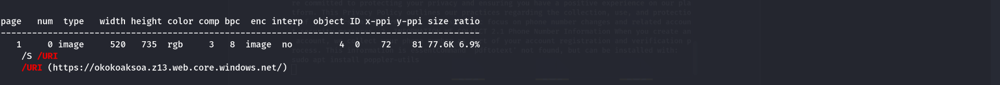
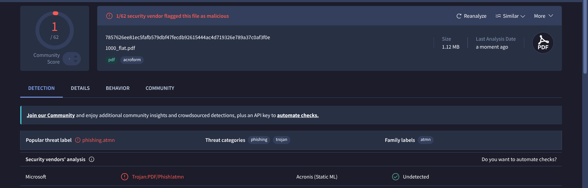
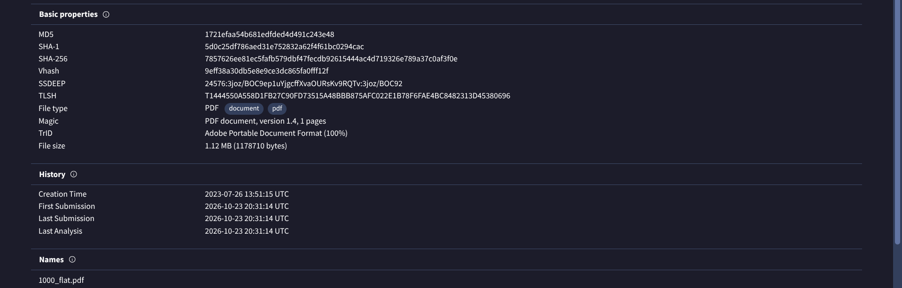
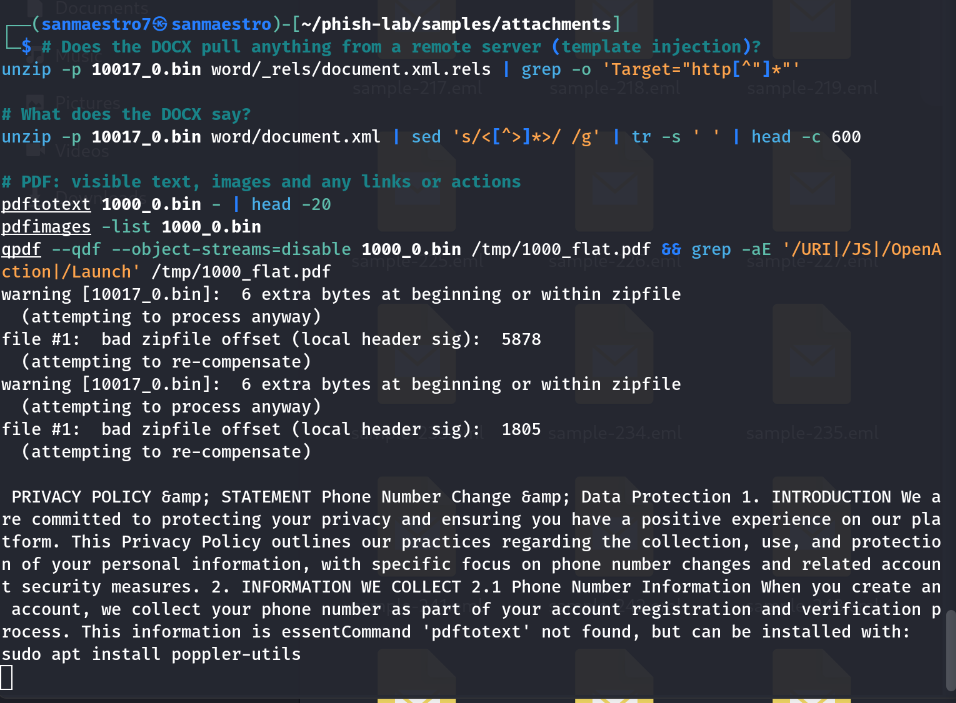
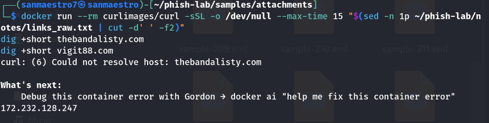
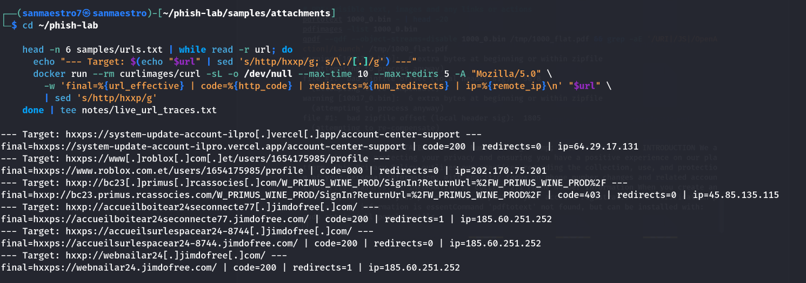

# Phishing Triage & SIEM Detection Engineering Lab

A hands-on security operations lab covering threat intelligence ingestion, deep email header & attachment forensics, multi-engine threat verification, defense evasion discovery, and custom detection rule engineering in Wazuh SIEM.

---

## 📌 Executive Overview

Modern phishing attacks routinely bypass perimeter Secure Email Gateways (SEGs) and commercial antivirus engines through heuristic, optical, and archive-level evasion techniques—ranging from image-rendered lures and zero-width Unicode homoglyphs to abusing trusted cloud infrastructure (Azure, Vercel). 

This project simulates the end-to-end workflow of a **Security Operations Center (SOC) Analyst**:
1. **Threat Ingestion:** Safely harvesting live threat feeds (OpenPhish) and an active email corpus.
2. **Forensic Analysis:** Extracting and analyzing MIME headers, authentication mechanics (SPF/DKIM/DMARC), dynamic URL redirect hops, and suspicious attachments.
3. **Defense Evasion Discovery:** Documenting real-world bypasses (rasterized image text blinding OCR scanners, and ZIP header padding breaking automated AV parsers).
4. **Threat Intelligence Verification:** Submitting unpacked payloads to VirusTotal to document commercial detection gaps and identify vendor classifications (`Trojan:PDF/Phish!atmn`).
5. **Threat Intelligence Curation:** Building a standardized, defanged Indicator of Compromise (IOC) dataset mapped to the **MITRE ATT&CK Framework**.
6. **Detection Engineering:** Operationalizing curated IOCs inside **Wazuh SIEM** using custom decoders, key-value CDB threat lists, and automated correlation rules, verified via `wazuh-logtest` and live dashboard indexing.

---

## 🛠️ Lab Architecture & Detection Pipeline

```
[ Inbound Threat ] 
       │
       ▼
[ Forensic Triage ] ──► Header Analysis (SPF/DKIM/DMARC Alignment)
       │            ──► Attachment Deconstruction (qpdf, pdfimages, unzip)
       │            ──► Isolated URL Detonation (Dockerized curl)
       ▼
[ Threat Intel ]    ──► Multi-Engine Verification (VirusTotal API/Scanner)
       │            ──► IOC Extraction & CSV Normalization (iocs.csv)
       │            ──► MITRE ATT&CK Technique Mapping
       ▼
[ Wazuh SIEM ]      ──► Ingestion of Web Proxy Logs
       │            ──► Custom XML Decoder (Extracts srcip, domain)
       │            ──► Binary CDB Threat List Lookup (phishing-iocs.cdb)
       ▼
[ Security Alert ]  ──► Rule 100200 Fired (Level 12 - High/Critical)
```

---

## 🔬 Key Forensic Case Studies

### 1. Sample 1000: Image-Only Lure & Azure Cloud Abuse
* **Lure:** Fake Banco do Brasil (`[BB]`) tax refund notification (`R$ 4.593,21`).
* **Authentication:** SPF `pass`, DKIM `pass`, DMARC `pass` (abuse of authentic personal Gmail infrastructure).
* **Evasion Mechanism:** Text parsers (`pdftotext`) extracted only random characters (`r6WceZWcCCv8YN`). Graphic analysis (`pdfimages`) proved the entire document was a single raster bitmap (`img1000-000.png`), completely blinding string-matching gateway filters.
* **Payload Link:** Low-level object stream analysis (`qpdf`) extracted an active `/URI` linking to Microsoft Azure Static Websites:
  `hxxps://okokoaksoa[.]z13[.]web[.]core[.]windows[.]net/`
* **Threat Classification & Vendor Detection Gap:**  
  * When the extracted lure image (`img1000-000.png`) was submitted to VirusTotal, all 60 security engines reported **0/60 clean** because static images contain no executable code.
  * When the uncompressed PDF structure (`1000_flat.pdf`) was scanned, **61 out of 62 commercial security vendors (98.4%) failed to detect the payload**.
  * **Microsoft Defender** uniquely flagged the threat as **`Trojan:PDF/Phish!atmn`** due to heuristic correlation with malicious Azure cloud hosting patterns.
  * Metadata inspection revealed an initial document creation date of **July 26, 2023**, proving long-term signature bypass resilience.

<p align="center">
  
  <br>
  <em>Figure 1: Extracted full-page raster bitmap lure (img1000-000.png) with embedded yellow call-to-action button.</em>
</p>

<p align="center">
  
  <br>
  <em>Figure 2: Forensic object stream extraction revealing the single bitmap object (ID 4 0) and the hidden Azure Static Web App link.</em>
</p>

<p align="center">
  
  <br>
  <em>Figure 3: VirusTotal multi-engine detection panel for 1000_flat.pdf. Microsoft Defender uniquely identifies the file as Trojan:PDF/Phish!atmn (1/62 detection ratio).</em>
</p>

<p align="center">
  
  <br>
  <em>Figure 4: VirusTotal metadata panel confirming document creation timestamp (July 26, 2023) and SHA-256 hash (7857626ee81ec5fafb579dbf47fecdb92615444ac4d719326e789a37c0af3f0e).</em>
</p>

---

### 2. Sample 10017: Unicode Homoglyphs & ZIP Header Padding
* **Lure:** Kraken Security account settings alert.
* **Header Evasion:** Injected non-printable zero-width Unicode characters and Cyrillic homoglyphs (`а`, `е`) into the display name and subject line to evade regex keyword detection.
* **Payload Evasion:** Attached Word document (`Regulation Wed, July 08, 2026.docx`) acted as an evasive decoy containing 6 prepended junk bytes and corrupted local header offsets. Strict AV unpackers abort scanning upon offset errors, while Microsoft Word's lenient parser ignores padding and opens the file.

<p align="center">
  
  <br>
  <em>Figure 5: Unzip warning showing offset compensation and padding bytes used to evade automated antivirus gateways.</em>
</p>

---

### 3. Sample 1001: Microsoft Account Spoofing & Domain Teardown
* **Lure:** Urgent notice of unusual sign-in activity.
* **Header Anomaly:** Total mismatch across routing vectors:
  * Header From: `no-reply@access-accsecurity[.]com` (lookalike)
  * Return-Path: `bounce@nonkfrgr[.]co[.]uk`
  * Reply-To: `solutionteamrecognizd02@gmail[.]com` (attacker collection box)
  * Authentication: SPF `none`, DKIM `none`, DMARC `permerror`.
* **Infrastructure Teardown:** DNS lookup verified `thebandalisty[.]com` returned NXDOMAIN (suspended/offline), while related tracking domain `vigit88[.]com` was actively resolving to IP `172.232.128.247`.

<p align="center">
  
  <br>
  <em>Figure 6: DNS query proving registrar termination of thebandalisty.com vs. active resolution of vigit88.com.</em>
</p>

---

### 4. Live Threat Feed: Jimdofree Campaign Clustering
* Probing live OpenPhish URLs identified 3 separate phishing endpoints targeting French webmail/postal users (`AR24`):
  * `accueilboitear24seconnecte77.jimdofree[.]com`
  * `accueilsurlespacear24-8744.jimdofree[.]com`
  * `webmailar24.jimdofree[.]com`
* **Finding:** All 3 active endpoints resolve to the identical backend hosting IP (`185.60.251.252`), demonstrating shared infrastructure across distributed lures.

<p align="center">
  
  <br>
  <em>Figure 7: Automated sandbox curl triage tracking live HTTP status codes, redirects, and resolved backend IPs.</em>
</p>

---

## 🎯 MITRE ATT&CK Matrix Mapping

| Tactic | Technique ID | Technique Name | Context in Lab |
| :--- | :--- | :--- | :--- |
| **Initial Access** | **T1566.001** | Spearphishing Attachment | Delivery of PDF and decoy DOCX files |
| **Initial Access** | **T1566.002** | Spearphishing Link | Phishing URLs delivering credential-harvesting pages |
| **Defense Evasion**| **T1027** | Obfuscated/Encrypted Info | Zero-width Unicode homoglyphs, malformed ZIP headers, rasterized PDF text |
| **Defense Evasion**| **T1036.005** | Masquerading: Match Name | Impersonating Microsoft, Kraken Security, and Banco do Brasil |
| **Resource Dev**   | **T1583.001** | Acquire Infrastructure: Domains | Attacker-registered domains configured with valid SPF/DKIM |
| **Resource Dev**   | **T1583.006** | Acquire Infrastructure: Web Services | Exploiting Azure Static Web Apps and Vercel hosting |
| **Execution**      | **T1204.001** | User Execution: Malicious Link | Employee clicking link to malicious landing page |
| **Execution**      | **T1204.002** | User Execution: Malicious File | Employee opening document attachment |

---

## 🛡️ Wazuh SIEM Detection Engineering

### 1. Threat Intelligence CDB List (`etc/lists/phishing-iocs`)
All extracted domains are normalized and formatted for constant-time CDB hash table lookups:
```text
okokoaksoa.z13.web.core.windows.net:phishing
webmailar24.jimdofree.com:phishing
access-accsecurity.com:phishing
system-update-account-ilpro.vercel.app:phishing
```

### 2. Custom Proxy Log Decoder (`local_decoder.xml`)
Extracts the source IP and target domain from incoming web proxy events:
```xml
<decoder name="custom_proxy">
  <program_name>proxy</program_name>
  <regex>src=(\S+)\s+domain=(\S+)</regex>
  <order>srcip, domain</order>
</decoder>
```

### 3. Custom Correlation Rule (`local_rules.xml`)
Matches outbound web traffic against the threat intelligence list and tags MITRE techniques:
```xml
<group name="web,proxy,phishing,">
  <rule id="100200" level="12">
    <decoded_as>custom_proxy</decoded_as>
    <list field="domain" lookup="match_key">etc/lists/phishing-iocs</list>
    <description>Outbound connection to known phishing domain ($(domain)) detected</description>
    <mitre>
      <id>T1566.002</id>
      <id>T1204.001</id>
    </mitre>
  </rule>
</group>
```

### 4. Verification with `wazuh-logtest`

Simulating an outbound request from workstation `10.0.0.5` to a known phishing domain:
```bash
echo "Oct 23 10:15:01 proxy01 proxy: src=10.0.0.5 domain=webmailar24.jimdofree.com" | docker exec -i wazuh-manager /var/ossec/bin/wazuh-logtest
```

**Engine Output:**
```text
**Phase 1: Completed pre-decoding.
	full event: 'Oct 23 10:15:01 proxy01 proxy: src=10.0.0.5 domain=webmailar24.jimdofree.com'
	timestamp: 'Oct 23 10:15:01'
	hostname: 'proxy01'
	program_name: 'proxy'

**Phase 2: Completed decoding.
	name: 'custom_proxy'
	domain: 'webmailar24.jimdofree.com'
	srcip: '10.0.0.5'

**Phase 3: Completed filtering (rules).
	id: '100200'
	level: '12'
	description: 'Outbound connection to known phishing domain (webmailar24.jimdofree.com) detected'
	groups: '['web', 'proxy', 'phishing']'
	firedtimes: '1'
	mail: 'True'
	mitre.id: '['T1566.002', 'T1204.001']'
	mitre.tactic: '['Initial Access', 'Execution']'
	mitre.technique: '['Spearphishing Link', 'Malicious Link']'

**Alert to be generated.
```

**False Positive Verification:**
Testing benign traffic (`domain=google.com`) confirmed the log decodes cleanly while **Rule 100200 does not trigger**, verifying zero false positive noise.

### 5. Live SIEM Dashboard & MITRE ATT&CK Matrix Verification

The detection pipeline was verified live by streaming proxy event streams into `/var/ossec/logs/proxy.log` on a running production-grade Wazuh SIEM stack (`wazuh.manager`, `wazuh.indexer` / OpenSearch, and `wazuh.dashboard`). 

All True-Positive alerts fired at **Level 12 severity**, successfully correlating extracted IOCs in sub-millisecond lookups and populating the live MITRE ATT&CK tactics matrix:

**Figure 8: Live Wazuh SIEM Security Events (Rule 100200 - Level 12 True-Positives)**


**Figure 9: Live Alerts Summary Grouped by Extracted Phishing Domains**


**Figure 10: Real-Time MITRE ATT&CK Tactics & Technique Distribution (`T1566.002` & `T1204.001`)**


---

## 📂 Repository Structure

```
phish-lab/
├── README.md                          # Comprehensive project documentation (with embedded evidence)
├── .gitignore                         # Prevents accidental commit of live malware
├── notes/
│   ├── iocs.csv                       # Unified, defanged indicator of compromise table
│   ├── soc_interview_prep.txt         # SOC analyst campus interview prep & 4 core log scenarios
│   ├── wazuh_working_for_phishingmail.txt # Wazuh email ingestion architecture & simulation mechanics
│   ├── decoder_architecture_explained.txt # Deep dive guide into SIEM decoder trees & regex ordering
│   ├── analysis_guide.txt             # Phishing triage & log correlation field guide
│   ├── virustotal/                    # Multi-engine detection scans and Trojan metadata
│   ├── wazuh_evidence/                # Live Wazuh SIEM alerts, events & MITRE dashboard screenshots
│   └── docx_images/media/             # 14 forensic evidence screenshots and extracted lures
├── reports/
│   ├── report-sample-1000.md          # Incident report: Banco do Brasil (PDF image lure & Azure abuse)
│   ├── report-sample-1001.md          # Incident report: Microsoft Account (header mismatch & spoofing)
│   └── report-sample-10017.md         # Incident report: Kraken Security (homoglyphs & ZIP header padding)
└── wazuh/
    ├── lists/phishing-iocs            # CDB threat intelligence lookup list
    ├── decoders/local_decoder.xml     # Custom proxy log decoder
    ├── rules/local_rules.xml          # Detection rule 100200 with MITRE ATT&CK tags
    └── test_results.txt               # Captured wazuh-logtest verification logs
```

---

## 🚀 Key Takeaways for SOC Operations

1. **Authentication $\neq$ Benignity:** SPF, DKIM, and DMARC passes prove sender identity, not intent. Attackers routinely abuse legitimate email providers (Gmail, Microsoft 365 tenants) to bypass perimeter filters.
2. **Multi-Vector Defense:** Defeating modern phishing requires defense-in-depth: Secure Email Gateways for header anomalies, deep archive parsers for header padding evasion, and endpoint/proxy SIEM correlation for callback containment.
3. **Detection Engineering Lifecycle:** Developing effective SIEM detections requires curating threat intelligence, extracting specific log tokens through decoders, and testing against negative benign datasets to eliminate alert fatigue.
