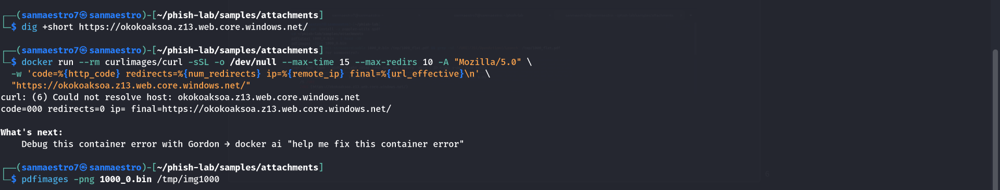

# Phishing Incident Report: Sample 1000

**Analyst:** Sanmaestro  
**Date:** October 23, 2026  
**Incident Type:** Optical/Image-Based Evasion with Cloud Storage Phishing  
**Severity:** HIGH  

---

## 1. Executive Summary
An incoming phishing email impersonating **Banco do Brasil ([BB])** was detected with the subject *"Liberação de IRPF - 6NwlyfzWcsNerv0"*. The threat actor leveraged an authentic, passing Gmail account to bypass traditional perimeter email authentication defenses, delivering an evasive single-page PDF attachment (`csWuYjyqO2IR.pdf`). 

Forensic deconstruction revealed that the PDF body contains no selectable text and is rendered completely as a single raster image to blind text/OCR parsers. An underlying clickable `/URI` annotation was discovered linking to a malicious credential-harvesting landing page abusing **Microsoft Azure Static Websites**.

---

## 2. Technical Evidence & Analysis

### 2.1 Sender & Authentication Analysis
* **Display Name:** `"[BB] - Seu saldo foi liberado - Código: 11084339647130851921"`
* **Header From & Return-Path:** `prestonconstance587@gmail[.]com`
* **Authentication Results:**
  * **SPF:** `pass` (`smtp.mailfrom=gmail.com`, origin IP: `209.85.160.178`)
  * **DKIM:** `pass` (`header.d=gmail.com`)
  * **DMARC:** `pass` (`header.from=gmail.com`)
* **Analytical Takeaway:** The attacker used a legitimate personal Gmail mailbox. This demonstrates that standard email security checks (SPF/DKIM/DMARC) establish sender authenticity, but cannot verify whether the content or intent is benign.

### 2.2 Attachment Deconstruction & Optical Evasion
* **File Name:** `csWuYjyqO2IR.pdf` (Saved as `1000_0.bin`, 97,566 bytes)
* **SHA-256:** `cfc5fbc7ec4a390d4fbb1b489a243a859437146522c0199e4b370ef3749330cf`
* **Text Extraction (`pdftotext`):** Yielded only randomized junk characters (`r6WceZWcCCv8YN`), successfully blinding signature and keyword filters searching for banking and tax terms.
* **Graphic Forensic (`pdfimages`):** Extracted `img1000-000.png` (`520x735`, 77.6 KB). The entire notification—the Banco do Brasil logo, CNPJ, refund amount of `R$ 4.593,21`, and yellow `"CLIQUE AQUI"` button—is a single bitmap graphic.

<p align="center">
  
  <br>
  <em>Figure 1: Extracted visual lure (img1000-000.png) proving the notice is a complete raster image without selectable text.</em>
</p>

### 2.3 Object Stream Callout & Cloud Infrastructure Abuse
Low-level object stream analysis (`qpdf`) extracted an active `/URI` action linked directly to the yellow button area:

```text
/S /URI
/URI (https://okokoaksoa.z13.web.core.windows.net/)
```

<p align="center">
  
  <br>
  <em>Figure 2: Object stream analysis showing the single RGB image object (ID 4 0) and the hidden Azure Static Web App URL.</em>
</p>

* **Infrastructure Analysis:** The destination abuses **Microsoft Azure Static Websites / Blob Storage** (`web.core.windows.net`) to leverage trusted cloud infrastructure and bypass domain reputation blocks.
* **Dynamic Sandbox Triage:** Curl probe inside a disposable container returned `code=000` (`curl: (6) Could not resolve host`), confirming the storage container was subsequently reported and deactivated.

<p align="center">
  
  <br>
  <em>Figure 3: Isolated Docker container probe confirming destination unreachability (HTTP 000).</em>
</p>

---

## 3. MITRE ATT&CK Mapping

| Tactic | Technique ID | Technique Name | Observation in Sample 1000 |
| :--- | :--- | :--- | :--- |
| **Initial Access** | **T1566.001** | Spearphishing Attachment | Delivery of weaponized PDF attachment. |
| **Defense Evasion**| **T1027** | Obfuscated/Encrypted Info | Image-only rendering to defeat automated OCR/text scrapers. |
| **Resource Dev**   | **T1583.006** | Acquire Infrastructure: Web Services | Exploitation of Microsoft Azure Static Web Apps. |
| **Execution**      | **T1204.002** | User Execution: Malicious File | Coaxing user to click the embedded PDF link. |

---

## 4. Indicators of Compromise (IOCs)

| IOC Type | Defanged Value | Context |
| :--- | :--- | :--- |
| **Email Address** | `prestonconstance587@gmail[.]com` | Originating sender address |
| **Sending IP** | `209[.]85[.]160[.]178` | Google mail relay IP |
| **File Hash (SHA-256)**| `cfc5fbc7ec4a390d4fbb1b489a243a859437146522c0199e4b370ef3749330cf` | Attached PDF file hash |
| **Domain** | `okokoaksoa.z13.web.core.windows.net` | Azure credential-harvesting landing domain |

---

## 5. Severity Assessment & Recommended Actions

* **Severity Rating:** **HIGH**
* **Recommended Actions:**
  1. **Network Block:** Block `okokoaksoa.z13.web.core.windows.net` at corporate web proxies and DNS resolvers.
  2. **EDR Threat Hunt:** Scan endpoints for PDF hash `cfc5fbc7...30cf` to determine if any internal users downloaded or opened the file.
  3. **Cloud Abuse Reporting:** Submit telemetry and domain details to the Microsoft Security Response Center (MSRC) to ensure tenant takedown.
  4. **User Security Awareness:** Educate staff that passing SPF/DKIM verification marks does not guarantee the safety of attachments.
