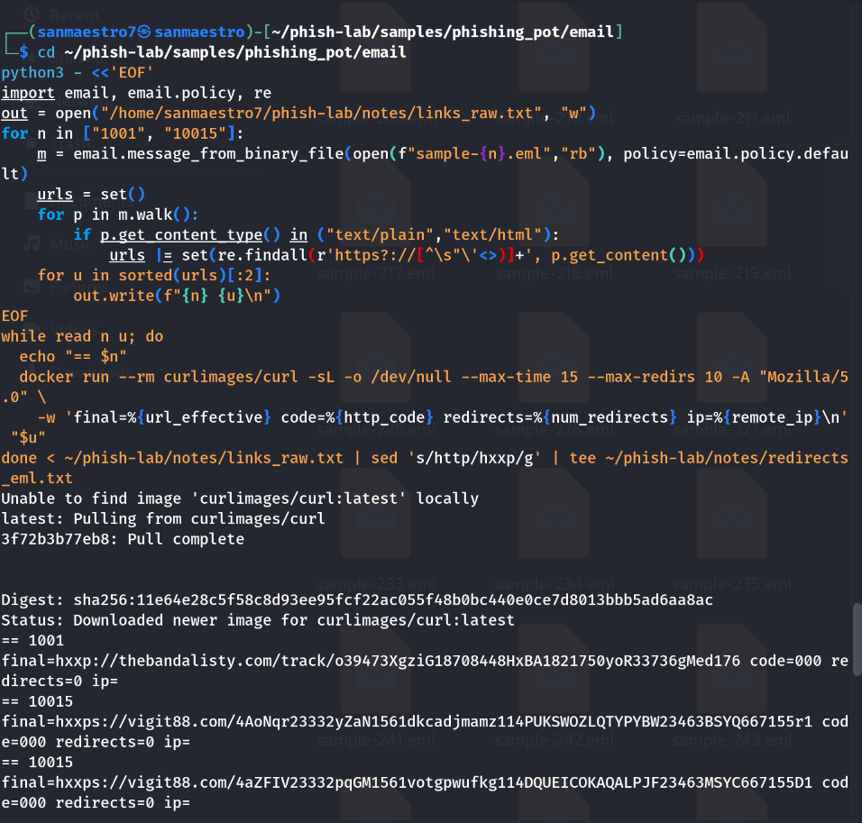

# Phishing Incident Report: Sample 1001

**Analyst:** Sanmaestro  
**Date:** October 23, 2026  
**Incident Type:** Unauthenticated Brand Impersonation & Credential Harvesting Lure  
**Severity:** HIGH  

---

## 1. Executive Summary
An external email impersonating the **Microsoft Account Team** was detected with the subject *"Microsoft account unusual signin activity"*. The email attempts to deceive users into interacting with an embedded link disguised as an account security response action. Technical examination indicates severe domain and routing anomalies with zero valid authentication, consistent with an unauthenticated credential-harvesting attempt.

---

## 2. Technical Evidence & Analysis

### 2.1 Sender Identity Manipulation & Header Mismatches
* **Display Name:** `"Microsoft account team"` (Brand impersonation)
* **Header From:** `no-reply@access-accsecurity[.]com` (lookalike domain)
* **Envelope Return-Path:** `bounce@nonkfrgr[.]co[.]uk`
* **Reply-To:** `solutionteamrecognizd02@gmail[.]com` (directing user communications to a free personal Gmail mailbox)
* **Authentication Posture:**
  * **SPF:** `spf=none` (`smtp.mailfrom=nonkfrgr.co.uk`, origin IP: `89.144.9.87`)
  * **DKIM:** `dkim=none` (message not cryptographically signed)
  * **DMARC:** `dmarc=permerror` (lookup/record misconfiguration prevented evaluation)

### 2.2 Dynamic URL Triage & Sandbox Detonation
* **Embedded Payload Link:**  
  `hxxp://thebandalisty[.]com/track/o39473XgziG18708448HxBA1821750yoR33736gMed176`
* Dynamic triage inside an isolated Docker curl container returned `code=000`, redirects=0, and an empty remote IP:

<p align="center">
  
  <br>
  <em>Figure 1: Isolated container execution showing HTTP status 000 on the tracking URL.</em>
</p>

### 2.3 DNS Resolution & Infrastructure Teardown
To distinguish between server timeout and full domain suspension, DNS lookups were executed:
```bash
dig +short thebandalisty.com
```
* **Result:** Returned `curl: (6) Could not resolve host: thebandalisty.com` (NXDOMAIN), confirming the domain was completely suspended/terminated by the registrar.
* **Correlated Check:** By contrast, sample 10015's tracking domain (`vigit88.com`) still actively resolved to IP `172.232.128.247`.

<p align="center">
  
  <br>
  <em>Figure 2: DNS resolution confirming NXDOMAIN on thebandalisty.com vs. active IP resolution on vigit88.com.</em>
</p>

---

## 3. MITRE ATT&CK Mapping

| Tactic | Technique ID | Technique Name | Context in Sample |
| :--- | :--- | :--- | :--- |
| **Initial Access** | **T1566.002** | Phishing: Spearphishing Link | Delivery of an unauthenticated email carrying an external link. |
| **Defense Evasion**| **T1036.005** | Masquerading: Match Legitimate Name | Display name spoofing `"Microsoft account team"`. |
| **Resource Dev**   | **T1583.001** | Acquire Infrastructure: Domains | Registration of `access-accsecurity[.]com` and `thebandalisty[.]com`. |
| **Collection**     | **T1598.003** | Phishing for Information: Link | Lure crafted to capture account credentials. |

---

## 4. Indicators of Compromise (IOCs)

| IOC Type | Defanged Value | Context |
| :--- | :--- | :--- |
| **Domain** | `access-accsecurity[.]com` | Lookalike sender From domain |
| **Domain** | `nonkfrgr[.]co[.]uk` | Return-Path envelope domain |
| **IP Address** | `89[.]144[.]9[.]87` | Sending server IP |
| **Email Address** | `solutionteamrecognizd02@gmail[.]com` | Exfiltration / Reply-To address |
| **Domain** | `thebandalisty[.]com` | Tracking / credential harvest domain |

---

## 5. Severity Assessment & Recommended Actions

* **Severity Rating:** **HIGH** (Brand impersonation targeting core enterprise identity).
* **Recommended Actions:**
  1. **Block & Filter:** Add `access-accsecurity[.]com` and `thebandalisty[.]com` to perimeter email and web gateway blocklists.
  2. **Quarantine:** Purge all emails originating from `89.144.9.87` or containing `solutionteamrecognizd02@gmail.com`.
  3. **User Triage & Escalation:** Query proxy/DNS logs for outbound connections to `thebandalisty[.]com`. Force password reset and revoke active sessions for any user with confirmed clicks.
