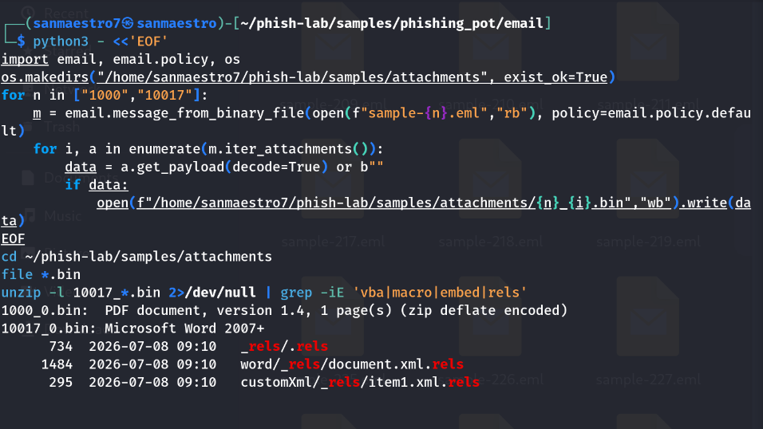

# Phishing Incident Report: Sample 10017

**Analyst:** Sanmaestro  
**Date:** October 23, 2026  
**Incident Type:** Defense Evasion via Header Homoglyphs & Malformed Archive Padding  
**Severity:** HIGH  

---

## 1. Executive Summary
A targeted spearphishing email was identified impersonating **Kraken Security Teams** under the subject *"Your Account Sесurіty Sеttіngs Chаngе. Mail#7452764391"*. The threat actor employed multiple layers of defense evasion, including zero-width non-printable characters and Cyrillic homoglyphs in the email headers to bypass regex-based security filters. 

The email delivered an evasive Microsoft Word decoy document (`Regulation Wed, July 08, 2026.docx`) alongside two zero-byte ghost attachments. Low-level archive analysis revealed deliberate ZIP header padding and bad offset anomalies, an evasion technique designed to trigger extraction failures in automated AV/sandbox inspection engines while still allowing Microsoft Word to execute the file.

---

## 2. Technical Evidence & Analysis

### 2.1 Header & Identity Obfuscation
* **Display Name:** `Κ󠄹󠄹r󠄹а󠄹󠄹󠄹k󠄹е󠄹󠄹ո󠄹 Secu󠄹󠄹rity Te󠄹󠄹ams`  
  *Analysis:* The attacker injected invisible Unicode zero-width tags (`U+E0139`, `U+E0137`) and substituted Latin characters with Cyrillic lookalikes (`а`, `е`). This defeats standard keyword matching rules looking for "Kraken" or "Security".
* **Subject Line:** Uses Cyrillic characters in `"Sесurіty Sеttіngs Chаngе"` for the same filtering evasion purpose.
* **Envelope Sender:** `kb@202330648[.]dptinfoalma[.]ca`
* **Sending Relay IP:** `209[.]85[.]221[.]53`

### 2.2 Authentication Analysis
* **SPF:** `pass` (`smtp.mailfrom=202330648.dptinfoalma.ca`)
* **DKIM:** `pass` (`header.d=202330648.dptinfoalma.ca`)
* **DMARC:** `pass` (`header.from=202330648.dptinfoalma.ca`)
* **Forensic Significance:** Passing authentication demonstrates that the adversary registered `dptinfoalma[.]ca` and configured correct DNS TXT/cryptographic records for their subdomain. This highlights a fundamental security principle: **SPF/DKIM verifies sender identity, not message intent**.

### 2.3 Attachment & Payload Forensics
* **Primary Payload:** `Regulation Wed, July 08, 2026.docx` (41,883 bytes)
  * **SHA-256:** `c8aae837a7f4577ceb797e5966df344ba8f3f01f07d393ca1c7eec73b18213e9`

<p align="center">
  
  <br>
  <em>Figure 1: Programmatic attachment extraction and OOXML package relationship verification.</em>
</p>

* **Archive Anomaly & AV Evasion:**  
  Running archive inspection revealed:
  ```text
  warning [10017_0.bin]: 6 extra bytes at beginning or within zipfile
  file #1: bad zipfile offset (local header sig): 5878
  ```
  *Analysis:* The attacker prepended junk bytes and corrupted local header offsets. Strict antivirus gateways and perimeter email filters often fail or abort parsing malformed ZIP archives, skipping inspection. However, Microsoft Word's lenient parser ignores leading padding and successfully opens the file.

<p align="center">
  
  <br>
  <em>Figure 2: Terminal output documenting local header signature offset warnings and benign decoy privacy text.</em>
</p>

* **Payload Content:**
  * No VBA macros (`vbaProject.bin`) or external HTTP template injection targets were identified.
  * Internal XML text preview revealed a decoy Privacy Statement (*"PRIVACY POLICY & STATEMENT Phone Number Change..."*) used to create an illusion of legitimacy and buy time.
* **Ghost Attachments:**
  * Two attachments (`E-Statement Wed, July 08, 2026`, `Privacy & Policy Wed, July 08, 2026`) were 0 bytes (SHA-256: `e3b0c442...b855`). These are used as parser-confusion artifacts.

---

## 3. MITRE ATT&CK Mapping

| Tactic | Technique ID | Technique Name | Observation in Sample 10017 |
| :--- | :--- | :--- | :--- |
| **Initial Access** | **T1566.001** | Spearphishing Attachment | Delivery of DOCX file via social engineering lure. |
| **Defense Evasion**| **T1027** | Obfuscated/Encrypted Info | Zero-width Unicode characters, Cyrillic homoglyphs, and malformed ZIP header offsets. |
| **Defense Evasion**| **T1036.005** | Masquerading: Match Name | Spoofing brand identity of Kraken Security. |
| **Resource Dev**   | **T1583.001** | Acquire Infrastructure: Domains | Registration of dynamic domain `202330648.dptinfoalma.ca` with passing SPF/DKIM. |
| **Execution**      | **T1204.002** | User Execution: Malicious File | Coaxing user to open DOCX attachment. |

---

## 4. Indicators of Compromise (IOCs)

| IOC Type | Defanged Value | Context |
| :--- | :--- | :--- |
| **Domain** | `202330648[.]dptinfoalma[.]ca` | Attacker sending subdomain |
| **Domain** | `dptinfoalma[.]ca` | Attacker parent apex domain |
| **IP Address** | `209[.]85[.]221[.]53` | Sending mail relay IP |
| **Email Address** | `kb@202330648[.]dptinfoalma[.]ca` | Attacker mailbox |
| **File Hash (SHA-256)** | `c8aae837a7f4577ceb797e5966df344ba8f3f01f07d393ca1c7eec73b18213e9` | Primary DOCX attachment |
| **File Name** | `Regulation Wed, July 08, 2026.docx` | Decoy document name |

---

## 5. Severity Assessment & Recommended Actions

* **Severity Rating:** **HIGH**
* **Containment & Remediation:**
  1. **Perimeter Block:** Add `*.dptinfoalma.ca` and `209.85.221.53` to email gateway blocklists.
  2. **EDR Fleet Sweep:** Query endpoint detection (EDR) across all workstations for file hash `c8aae837...13e9` or file creation matching `Regulation Wed, July 08, 2026.docx`.
  3. **Gateway Policy Hardening:** Implement Secure Email Gateway (SEG) rules to quarantine inbound emails containing zero-width Unicode characters or non-standard ASCII homoglyphs in display names.
  4. **User Verification:** Check mail logs to confirm whether any recipients opened or saved the attachment.
